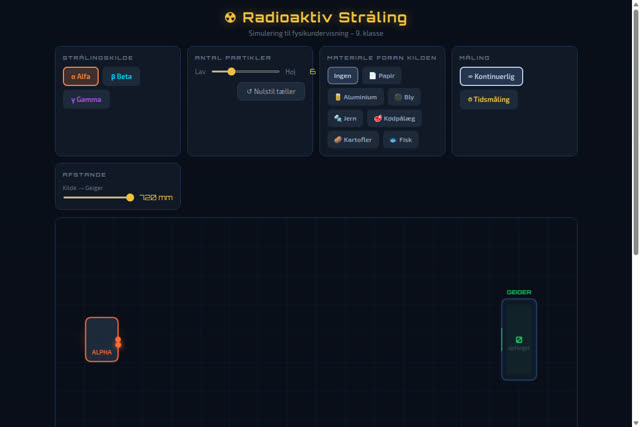
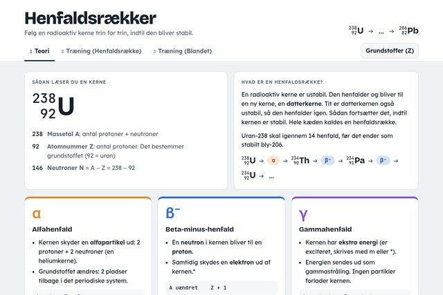
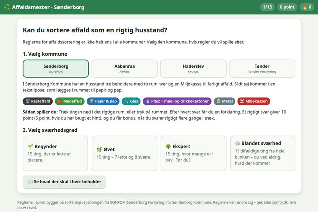
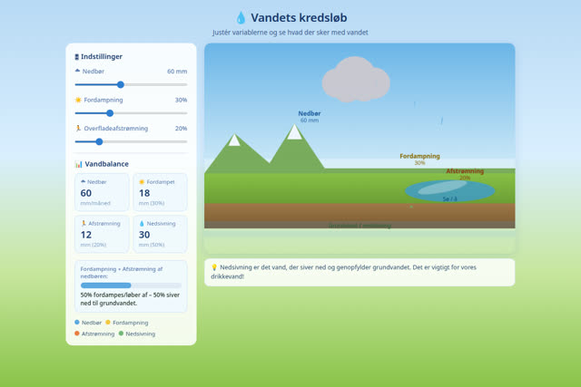
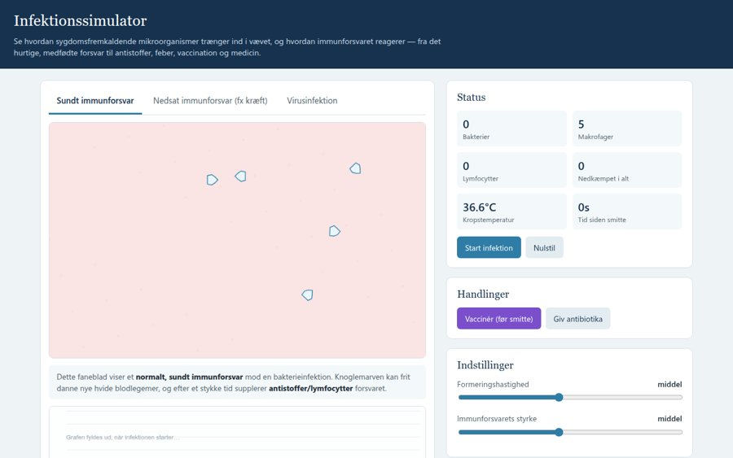
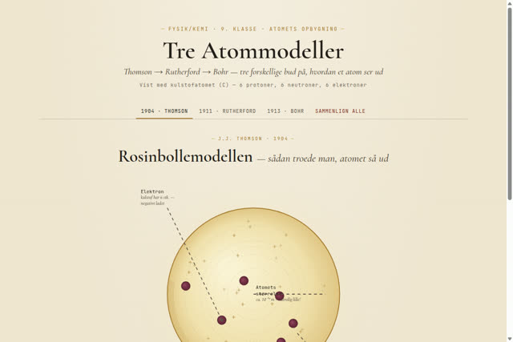
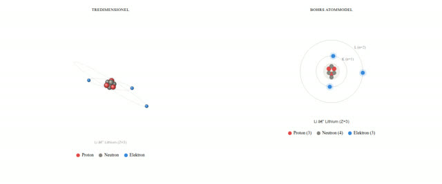
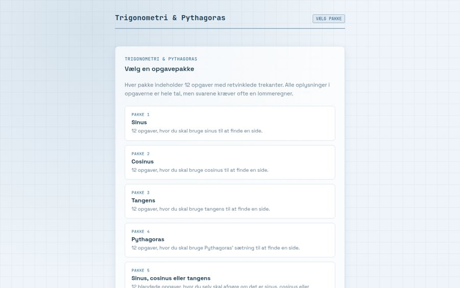

# 🔬 Naturfag i browseren

**Interaktive simuleringer, spil og ressourcer til naturfagsundervisningen i folkeskolen**

Alt kører direkte i browseren – ingen login, ingen installation. Klar til brug på computer, tablet og smartboard.

---

## 🧪 Simuleringer og spil

Træk, drej, justér og eksperimentér. Klik på et billede for at åbne simuleringen.

<table>
  <tr>
    <td width="33%" align="center">
       
      <b>☢️ Radioaktiv stråling</b> 
      Alfa, beta og gamma gennem papir, metaller, mad og hverdagsting som betonflise, glasplade, træskive og cowboystof – målt med en Geiger-tæller
    </td>
    <td width="33%" align="center">
       
      <b>⚛️ Henfaldsrækker</b> 
      Følg en kerne gennem α-, β⁻- og γ-henfald, til den bliver stabil
    </td>
    <td width="33%" align="center">
       
      <b>♻️ Affaldsmester</b> 
      Sortér affald efter reglerne i Sønderborg, Aabenraa, Haderslev og Tønder
    </td>
  </tr>
  <tr>
    <td width="33%" align="center">
       
      <b>💧 Vandets kredsløb</b> 
      Nedbør, fordampning, afstrømning og grundvand i mark, by og skov
    </td>
    <td width="33%" align="center">
       
      <b>🦠 Infektionssimulator</b> 
      Immunforsvar, antistoffer, feber, vaccination og antibiotikaresistens
    </td>
    <td width="33%" align="center">
       
      <b>🔭 Tre atommodeller</b> 
      Fra Thomson over Rutherford til Bohr
    </td>
  </tr>
  <tr>
    <td width="33%" align="center">
       
      <b>🌀 Lithium i 3D og 2D</b> 
      Roterbar 3D-model side om side med Bohrs skalmodel
    </td>
    <td width="33%" align="center">
       
      <b>📐 Trigonometri &amp; Pythagoras</b> 
      Træn sinus, cosinus, tangens og Pythagoras med direkte feedback
    </td>
    <td width="33%" align="center">
      <a href="https://froksen.github.io/simuleringer/jorden-solen-og-maanen.html"><b>🌍☀️🌙</b></a> 
      <b>Jorden, Solen og Månen</b> 
      Døgn og årstider – lige nu eller på et valgt tidspunkt  
      <a href="https://froksen.github.io/simuleringer/kortprojektioner.html"><b>🗺️</b></a> 
      <b>Fra globus til kort</b> 
      Mercator, arealtro kort, plan og kegle – og hvordan de forvrænger
    </td>
  </tr>
</table>

<a href="https://froksen.github.io/simuleringer/"><b>➜ Se hele oversigten med videoer, animationer og arbejdsark</b></a>

---

## 📚 Den fællesfaglige naturfagsprøve

Ressourcer til den fællesfaglige naturfagsprøve i 9. klasse – fysik/kemi, biologi og geografi samlet ét sted.

<table>
  <tr>
    <td width="25%" align="center"><h3>🧩</h3><b>53 delemner</b> med undersøgelsesforslag og faglige fokusområder</td>
    <td width="25%" align="center"><h3>🎬</h3><b>Videoer</b> et YouTube-søgelink til hvert delemne</td>
    <td width="25%" align="center"><h3>📰</h3><b>Artikler</b> links til DR til hvert delemne</td>
    <td width="25%" align="center"><h3>🧪</h3><b>Simuleringer</b> en interaktiv simulering til hvert delemne</td>
  </tr>
</table>

<a href="https://froksen.github.io/fff/"><b>➜ Gå til naturfagsprøven</b></a>

---

## 🧭 Andre projekter

Interaktive kort og værktøjer, der ikke hører til et bestemt fag.

- 🏫 **[Skolekort Sønderborg](https://froksen.github.io/Andre%20projekter/)** – se skolerne i Sønderborg Kommune på et kort

---

Lavet til undervisningen af Ole Frandsen

